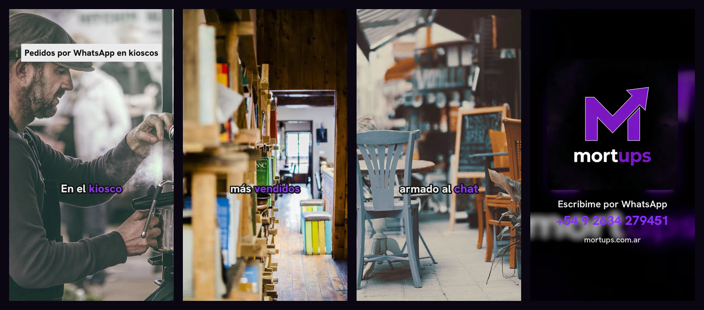
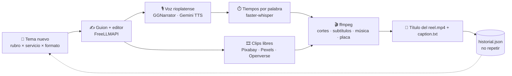

<div align="center">

# mortline

**Un comando, un reel.** Pipeline que escribe, locuta, ilustra y edita reels verticales para
[mortups](https://mortups.com.ar), 100% con herramientas gratis.




</div>

```console
$ mortline
● [1/6] Escribiendo el guion con FreeLLMAPI…
   Gancho: En el kiosco, contestar pedidos por WhatsApp te come el día.
● [2/6] Grabando la voz con GGNarrator (Puck)…
● [3/6] Sincronizando subtítulos palabra por palabra (Whisper)…
● [4/6] Buscando clips libres en pixabay…
● [5/6] Armando el video (cortes, placa final, música, subtítulos)…
● [6/6] Guardando caption, créditos e historial…
✅ Listo · 17.6 s de reel
```

## Qué hace



| Paso | Herramienta | Costo |
|---|---|---|
| Elegir un tema que nunca se hizo | `historial.json`: 10 rubros × 6 servicios × 7 formatos | $0 |
| Guion + segunda pasada de "editor" | [FreeLLMAPI](https://github.com/tashfeenahmed/freellmapi) (router de modelos gratis) | $0 |
| Locución natural en rioplatense | [GGNarrator](https://github.com/themortamc/GGNarrator) (Gemini TTS) | $0 |
| Subtítulos sincronizados palabra por palabra | [faster-whisper](https://github.com/SYSTRAN/faster-whisper) local, alineado al guion | $0 |
| Clips de stock | Pixabay / Pexels (videos) u Openverse (fotos CC0) | $0 |
| Música de fondo | Tus mp3, o loops lofi CC0 bajados solos | $0 |
| Edición | ffmpeg + libass | $0 |

## Diseñado para el algoritmo

Cada decisión de edición sale de cómo rankean hoy Reels, TikTok y Shorts: **watch time / % visto**,
**envíos por alcance** y **que no swipeen en el primer segundo**.

- **Gancho doble desde el cuadro 1**: título en caja blanca arriba + voz que arranca sin silencio.
- **Cortes cada ~2,4 s**: nunca más de 3 s con la misma imagen.
- **30 a 40 segundos** (mínimo 30 s de voz; si el guion queda corto se reescribe, hasta 2 veces, y si no llega hay error: nunca se rellena con silencio).
- **Subtítulos quemados** palabra por palabra, con la palabra activa en el color de acento del estilo (mucha gente mira sin sonido).
- **Placa final corta** (1,3 s) con logo, WhatsApp y web.
- **Caption con palabras que se buscan** ("catálogo web para ferretería") + invitación a mandárselo a otro comerciante (los envíos pesan mucho para llegar a no seguidores).
- **Variedad automática** de rubro, formato, gancho, clips y música: las plataformas castigan el contenido repetitivo y "no original".
- **Audio a -14 LUFS**, el estándar de las apps.

## Instalación

Requisitos: Linux/macOS, [uv](https://docs.astral.sh/uv/), `ffmpeg` con libass, FreeLLMAPI corriendo y un deploy de GGNarrator.

```bash
git clone https://github.com/themortamc/mortline.git && cd mortline
uv sync
cp .env.example .env   # completá GGNARRATOR_URL y, si tenés, PIXABAY_API_KEY
```

Atajo para usarlo desde cualquier carpeta:

```bash
cat > ~/.local/bin/mortline <<'EOF'
#!/usr/bin/env bash
exec uv run --quiet --project "$HOME/ruta/a/mortline" mortline "$@"
EOF
chmod +x ~/.local/bin/mortline
```

## Uso

```bash
mortline                         # elige solo un tema nuevo y hace el reel
mortline --rubro ferreterias     # tema nuevo de ese rubro
mortline "cómo dejar de pasar precios por audio"   # tema libre
mortline --cantidad 5            # tanda de 5 reels distintos
mortline --voz Kore              # otra voz (Puck, Fenrir, Charon, Kore, Zephyr)
mortline --estilo stock          # clips de stock en vez de motion graphics (el default es animado)
mortline --estilo-visual neon --formato mito-verdad   # elegir estilo y formato (si no, rotan solos)
mortline --rehacer "Título del reel"   # rehace imágenes y video con la misma voz y guion (título o carpeta)
mortline historial               # lo que ya se hizo
```

Cada reel queda en `~/Downloads/job/reels/<Título>/` (se cambia con `MORTLINE_SALIDA`; si el título existe, `<Título> (2)`):

```
<Título>.mp4   el video con el nombre de su título · 1080×1920 · H.264 + AAC · listo para subir
caption.txt    texto + hashtags para la publicación
portada.jpg    tapa para la grilla del perfil (título dentro del recorte 3:4)
```

El material de trabajo (`guion.json`, `voz.wav`, `creditos.txt`) queda aparte en `data/trabajo/<fecha>_<tema>/` (fuera de git).

## Estilo animado (por defecto)

Reels de motion graphics. Las plantillas viven en [`mortline/animado/escena.html`](mortline/animado/escena.html) (HTML/CSS/JS, 1080×1920,
30 fps) y se pintan **cuadro a cuadro** con Chromium headless (Playwright): Python fija el tiempo con `frame(t)`, así el
resultado es determinista y se junta con ffmpeg. Sin GPU, 1 a 2 minutos de render por reel.

**8 estilos visuales** ([`mortline/temas.py`](mortline/temas.py)), cada uno con su paleta, tipografía, fondo, lenguaje de movimiento y
subtítulos: `cuaderno`, `pizarra`, `editorial`, `ticket`, `planilla`, `neon`, `pop`, `minimal`. Rotan solos y no se repiten en los
últimos 4 reels (`--estilo-visual X` lo fuerza). El violeta de la marca queda solo en la placa final.

**8 formatos narrativos** ([`mortline/guion.py`](mortline/guion.py)): `problema-solucion`, `mito-verdad`, `top3-errores`, `cliente-tipo`,
`antes-despues`, `tutorial-3-pasos`, `dato-sorprendente`, `pregunta`. También rotan sin repetir los últimos 4 (`--formato Y`).

| Plantilla | Para qué |
|---|---|
| `titular` | gancho y remate: texto grande que entra palabra por palabra + ícono |
| `pasos` | lista numerada de 2 o 3 pasos |
| `flujo` | cajas unidas por flechas (antes → después, negocio → tu plata) |
| `dato` | número grande que sube con aro de progreso (solo cifras reales del brief) |
| `chat` | celular con conversación de WhatsApp |
| `grafico` | barras que crecen con línea de tendencia (sin cifras) |
| `mito` | el mito tachado palabra por palabra y la verdad abajo |
| `antes_despues` | panel partido: antes apagado, ahora con el acento del estilo |
| `ticket` | ticket térmico que se imprime de a tiras |
| `celdas` | planilla con celdas que se llenan y selección que salta |

Después de la voz, el LLM devuelve las escenas como JSON `[{desde, plantilla, textos, icono, resaltar}]`
(`desde` = número de palabra del guion); [`mortline/escenas.py`](mortline/escenas.py) lo valida, reintenta una vez y, si
falla, cae a escenas simples de texto. Los cortes salen de los tiempos de Whisper y ninguno dura más de ~3 s.
Íconos: [Lucide](https://lucide.dev) (ISC), vendorizados en `mortline/animado/iconos/`.
Primera vez: `uv run playwright install chromium`.

## Qué se guarda dónde

| Qué | Dónde |
|---|---|
| Código, marca, música CC0 | este repo |
| Historial (para no repetir temas, ganchos ni clips) | `data/historial.json`, se sube solo a GitHub después de cada reel |
| Reels terminados | `MORTLINE_SALIDA` (por defecto `~/Downloads/job/reels`), una carpeta por título |
| Guion, voz y créditos de cada reel | `data/trabajo/` (fuera de git; lo usa `--rehacer`) |
| Modelo de Whisper | `modelos/` (fuera de git, se baja solo la primera vez) |
| Claves | `.env` (fuera de git; copiá `.env.example`) |

Los clips descargados no se guardan: se borran al terminar cada reel.

## Personalizar

- **La marca** vive en [`marca/mortups.md`](marca/mortups.md): qué se vende, qué se puede decir, qué está prohibido y cómo habla. Cambiás ese archivo y cambian todos los guiones.
- **Temas**: rubros, servicios y formatos están en [`mortline/guion.py`](mortline/guion.py).
- **Música**: tirá tus mp3 en `music/` y usa esos en lugar de los CC0.
- **Ritmo**: `TOMA` y `COLA` en [`mortline/video.py`](mortline/video.py); `MAX_SEG` en [`mortline/escenas.py`](mortline/escenas.py).
- **Plantillas nuevas**: agregá una función en `PLANTILLAS` de `escena.html` y su nombre en `escenas.PLANTILLAS`.

## Créditos y licencias

- Código: MIT.
- Íconos: Lucide (ISC, licencia en `mortline/animado/iconos/LICENSE-lucide.txt`).
- Fuentes (SIL Open Font License, en `assets/fonts/`): Hanken Grotesk, Poppins, DM Serif Display, Bungee, Lilita One, Caveat Brush, Patrick Hand, Gaegu, Courier Prime y Space Mono.
- Clips y música: de bancos libres; cada reel guarda sus fuentes en `creditos.txt`.
- Logo de mortups: marca registrada de su dueño, no incluida en la licencia MIT.
